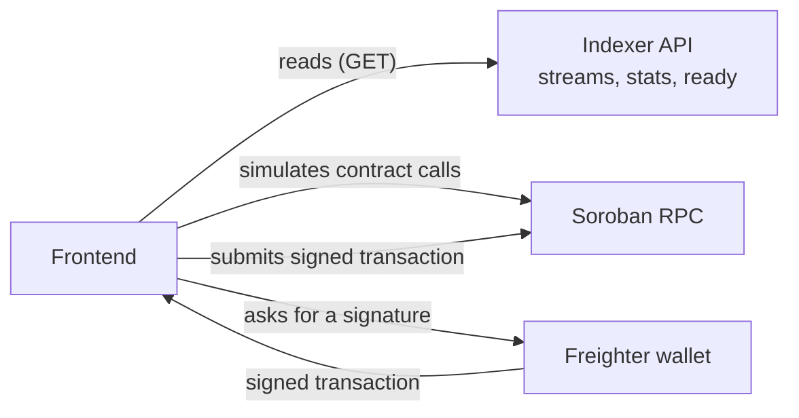

# Stellar Stream Hive — Frontend

A Next.js frontend for **Stellar Stream Hive**: employers create real-time payment streams to
employees on Stellar, and recipients watch their balance accrue by the second and withdraw
whenever they want. Built as part of an open-source Stellar Development Foundation grant
application.

## Related repositories

| Repo | Purpose |
| --- | --- |
| [`stellar-stream-hive-contract`](https://github.com/Stellar-Hive/stellar-stream-hive-contract) | Soroban smart contracts (Stream, Vault, Registry) |
| [`stellar-stream-hive-api`](https://github.com/Stellar-Hive/stellar-stream-hive-api) | Indexer/registry API used for stats and stream listings |
| `stellar-stream-hive-frontend` (this repo) | Next.js web app |

## Screenshots

Captured against testnet with throwaway test accounts — no real addresses, balances, or
transaction hashes. See [`docs/screenshots/README.md`](docs/screenshots/README.md) for the
capture steps and the full expected set; the images below are pending capture.

| The live, ticking balance | Create a stream | Streams you're sending |
| --- | --- | --- |
|  |  |  |

## The signature feature: LiveBalance

The core of the product is watching a recipient's withdrawable balance tick upward in real
time. `hooks/useLiveBalance.ts` mirrors the on-chain streaming formula client-side using BigInt
math (never floating point, always floored — the UI must never show more than the contract
would actually let you withdraw):

```
elapsed        = min(current_ledger, end_ledger) - start_ledger
total_duration = end_ledger - start_ledger
streamed       = floor(total_amount * elapsed / total_duration)
withdrawable   = streamed - withdrawn
```

It estimates the current ledger between chain reads using Stellar's ~5s average ledger close
time, ticks once per second for a smooth counter, and re-syncs with the Soroban RPC endpoint
every 30 seconds to correct for drift. Actual withdrawals always re-fetch the real on-chain
amount before submitting — the ticking estimate is a UI affordance, never the source of truth
for a transaction.

## npm scripts

| Script | Description |
| --- | --- |
| `dev` | Start the Next.js development server |
| `build` | Production build |
| `start` | Serve the production build |
| `lint` | Run ESLint |
| `typecheck` | Run the TypeScript compiler with `--noEmit` |
| `test` | Run Vitest once |
| `test:watch` | Run Vitest in watch mode |

## Tech stack

- [Next.js 14](https://nextjs.org/) (App Router) + TypeScript
- [Tailwind CSS](https://tailwindcss.com/) (dark mode by default)
- [`@stellar/stellar-sdk`](https://github.com/stellar/js-stellar-sdk) for building/simulating/submitting Soroban transactions
- [`@stellar/freighter-api`](https://github.com/stellar/freighter) for wallet connection and signing
- [Recharts](https://recharts.org/) for data visualization
- [date-fns](https://date-fns.org/) for date formatting

## Getting started

```bash
npm install
cp .env.example .env.local   # then fill in values, see below
npm run dev
```

Open [http://localhost:3000](http://localhost:3000).

## npm scripts

| Command | What it does |
| --- | --- |
| `npm run dev` | Starts the development server on [http://localhost:3000](http://localhost:3000) with hot reload |
| `npm run build` | Creates a production build and runs the full TypeScript and Next.js checks |
| `npm run start` | Serves the production build made by `npm run build` |
| `npm run lint` | Runs ESLint with the `next/core-web-vitals` rules |
| `npm run typecheck` | Runs `tsc --noEmit` in strict mode |
| `npm test` | Runs the Vitest unit tests once |
| `npm run test:watch` | Runs the Vitest unit tests and re-runs them on every file change |

## Environment variables

See [`.env.example`](./.env.example) for the full, documented list. In short:

- `NEXT_PUBLIC_STREAM_CONTRACT_ID`, `NEXT_PUBLIC_VAULT_CONTRACT_ID`, `NEXT_PUBLIC_REGISTRY_CONTRACT_ID` —
  Soroban contract IDs. `.env.example` ships with the **testnet** deployment from 2026-10-12
  (recorded in the contracts repo's `DEPLOYMENTS.md`), so `cp .env.example .env.local` gives a
  working testnet setup. A redeploy creates new ids; update these from `scripts/deploy.sh`'s output.
  On any other network leave them blank and contract-calling features show a clear "not yet
  configured" state rather than failing silently.
- `NEXT_PUBLIC_STELLAR_NETWORK`, `NEXT_PUBLIC_STELLAR_NETWORK_PASSPHRASE`,
  `NEXT_PUBLIC_SOROBAN_RPC_URL` — network configuration, defaulted to Stellar testnet.
- `NEXT_PUBLIC_API_BASE_URL` — base URL for the indexer API (`stellar-stream-hive-api`), used for
  platform-wide stats and listing streams by sender/recipient. If unset, the app shows a
  graceful empty/loading state rather than fabricating numbers.
- `NEXT_PUBLIC_SITE_URL` — public base URL this app is deployed at, used for `metadataBase`
  (Open Graph URLs) in `app/layout.tsx` and for the generated sitemap in `app/sitemap.ts`.
  Defaults to `http://localhost:3000`; set it to your real deployment URL in production so
  Open Graph previews and the sitemap don't point at a placeholder domain.

## Project structure

```
app/
  page.tsx                    Landing page (hero, no-wallet live demo, platform stats)
  streams/new/page.tsx        Create a stream
  streams/[id]/page.tsx       Stream detail (timeline, live balance, withdraw/cancel)
  sending/page.tsx            Streams the connected wallet is sending
  receiving/page.tsx          Streams the connected wallet is receiving
components/
  wallet/                     Freighter connect button, network indicator
  stream/                     LiveBalance, StreamCard, timeline, withdraw/cancel, etc.
  create/                     Create-stream form fields and live preview
  landing/                    Landing-page-only sections (demo, stats)
  layout/                     Nav bar, footer
  ui/                         Generic primitives (spinner, empty/error states, copy button)
hooks/
  useWallet.ts                Freighter connection state
  useLiveBalance.ts           The per-second ticking balance hook
  useStream.ts / useStreams.ts  Data loading for one stream / lists of streams
lib/
  contracts.ts                Soroban contract call helpers (create/withdraw/cancel)
  freighter.ts                Freighter API wrapper with normalized error handling
  stellar.ts                  Network config, RPC client, address validation
  streaming.ts                Client-side streamed-amount math (mirrors the contract)
  format.ts                   BigInt <-> decimal string formatting, address shortening
  api.ts                      Indexer API client
types/index.ts                 Shared domain types
```

## Verifying the build

```bash
npm run build
```

This runs a full TypeScript + Next.js production build and must succeed with no type errors.

## Troubleshooting

**Freighter is not detected.** The app shows a "not installed" message with an install link
when the browser has no Freighter extension. Install it from
[freighter.app](https://www.freighter.app/), reload the page, then connect again.

**"Wrong network selected in Freighter. Expected TESTNET, got …".** Freighter is on a different
network from the one this app is configured for. Open Freighter, switch the network to
**Testnet**, and reconnect. The expected network comes from `NEXT_PUBLIC_STELLAR_NETWORK`.

**"… contract ID is not configured."** One of `NEXT_PUBLIC_STREAM_CONTRACT_ID`,
`NEXT_PUBLIC_VAULT_CONTRACT_ID` or `NEXT_PUBLIC_REGISTRY_CONTRACT_ID` is empty. Copy
`.env.example` to `.env.local`, which ships the testnet ids, or set the ids for your own
deployment. Restart `npm run dev` after changing `.env.local`, because Next.js reads it only at
startup.

**CORS errors in the browser console when the app calls the API.** The indexer API
(`NEXT_PUBLIC_API_BASE_URL`) must allow requests from the origin you are running the app on,
such as `http://localhost:3000`. Check the API's CORS settings in
[`stellar-stream-hive-api`](https://github.com/Stellar-Hive/stellar-stream-hive-api), or point
`NEXT_PUBLIC_API_BASE_URL` at an instance that allows your origin. If the variable is empty, the
app shows an empty or loading state instead of data, which is expected.

**Stats or stream lists stay empty.** Confirm `NEXT_PUBLIC_API_BASE_URL` is set and that the
API is reachable. An unset variable is shown as an empty state, not as an error.

## Contributing

See [`CONTRIBUTING.md`](./CONTRIBUTING.md).

## License

MIT

## Testing

```bash
npm run lint        # ESLint (next/core-web-vitals)
npm run typecheck   # tsc --noEmit, strict mode
npm test            # Vitest unit tests (watch mode: npm run test:watch)
npm run build       # production build
```

All four run in CI on every push and pull request (`.github/workflows/ci.yml`).

The unit tests target the logic where a mistake would cost someone money or show
them a wrong balance, and run without a browser, wallet or network:

| Module | What is covered |
| --- | --- |
| `lib/streaming.ts` | The accrual formula against the contract's own test vectors: flooring, multiply-before-divide, cliff, monotonicity, BigInt precision beyond `Number.MAX_SAFE_INTEGER`, ledger/time estimation |
| `lib/format.ts` | Decimal parsing and formatting round-trips, truncation instead of rounding, address and explorer URL helpers |
| `lib/streamMapping.ts` | Mapping the indexer API's and the contract's responses into the app's `Stream` type |
| `lib/streamList.ts` | Status filters and CSV export (including spreadsheet-formula neutralisation) |

## Backend compatibility

The frontend talks to two backends, and `lib/streamMapping.ts` is the one place
that knows their wire formats:

- **Indexer API** (`NEXT_PUBLIC_API_BASE_URL`): `GET /stats`, `GET /ready`,
  `GET /streams/:id`, `GET /senders/:address`, `GET /recipients/:address`. List
  endpoints are paginated (200 per page); the client follows `X-Total-Count`
  until every page is loaded. Amounts arrive as decimal strings and are kept as
  strings until they are converted to `BigInt` for display.
- **Stream contract** (`NEXT_PUBLIC_STREAM_CONTRACT_ID`): `create_stream`,
  `withdraw(recipient, stream_id, amount)`, `cancel_stream(sender, stream_id)`,
  `withdrawable_amount` and `get_stream`. Argument order matters here — Soroban
  passes arguments positionally — and is pinned in `lib/contracts.ts`.

### Where each kind of data comes from



Reads come from the indexer API. Contract view calls and transaction simulations go through
Soroban RPC. Writes are signed in Freighter and then submitted to Soroban RPC.

## Stream lists

`/sending` and `/receiving` can be filtered by status (all / live / completed /
cancelled) and exported to CSV. The export contains exactly the streams currently
shown, with amounts as human-readable decimals.

## Troubleshooting

| Problem | Cause | Fix |
| --- | --- | --- |
| "Freighter not detected" | Freighter extension not installed or page loaded before it initialised | Install [Freighter](https://www.freighter.app/), reload the page, and ensure it is enabled for this site |
| Wrong network badge (e.g. Mainnet instead of Testnet) | `NEXT_PUBLIC_STELLAR_NETWORK` does not match the network selected in Freighter | Set the variable in `.env.local` to `testnet` or `mainnet` and restart the dev server |
| CORS errors calling the indexer API | `NEXT_PUBLIC_API_BASE_URL` points to a server that does not allow the app's origin | Verify the URL in `.env.local` and ensure the API's CORS config includes your origin |
| "Contract not configured" | `NEXT_PUBLIC_STREAM_CONTRACT_ID` is missing or invalid | Add the deployed contract ID to `.env.local` (see `.env.example`) |
