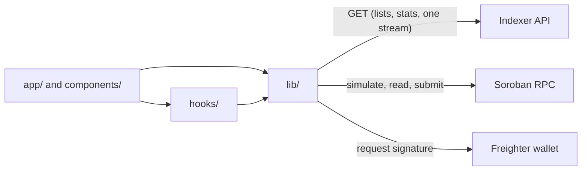

# Architecture

This document describes how the frontend is divided into modules, where each kind of data comes
from, and which modules are allowed to depend on which. The [README](../README.md) gives the
product overview and the file map; this page explains the reasons behind the layout.

## Layers

The code is split into four top-level areas. Each one has one job.

| Area | Job | Examples |
| --- | --- | --- |
| `app/` | Next.js App Router routes. Each `page.tsx` composes components and hooks for one screen. | `app/streams/[id]/page.tsx`, `app/sending/page.tsx` |
| `components/` | React UI, grouped by feature. Components render state and forward user actions. | `components/stream/LiveBalance.tsx`, `components/wallet/WalletProvider.tsx` |
| `hooks/` | React state and side effects: loading data, the ticking balance, the wallet connection. | `hooks/useStream.ts`, `hooks/useLiveBalance.ts`, `hooks/useWallet.ts` |
| `lib/` | Plain TypeScript with no React. Network clients, contract calls, math, formatting and validation. | `lib/api.ts`, `lib/contracts.ts`, `lib/streaming.ts` |

`types/index.ts` holds the shared domain types (`Stream`, and similar). Any layer may import
from it.

Keeping `lib/` free of React means its logic can be unit tested without a browser, wallet or
network, which is how the test suite in `lib/*.test.ts` works.

## Data sources

The frontend reads from two backends and writes through the wallet. Each kind of data has one
owner, so a value never comes from two places at once.

| Data | Source | Code |
| --- | --- | --- |
| Platform stats, stream lists by sender or recipient, one stream by id | Indexer API (`NEXT_PUBLIC_API_BASE_URL`) | `lib/api.ts` |
| Stream state, withdrawable amount, latest ledger | Soroban RPC, read through contract calls | `lib/contracts.ts`, `lib/stellar.ts` |
| Live balance between chain reads | Client-side estimate, never used for a transaction | `lib/streaming.ts`, `hooks/useLiveBalance.ts`, `hooks/useLedgerSnapshot.ts` |
| Wallet address, network, signatures | Freighter browser extension | `lib/freighter.ts`, `components/wallet/WalletProvider.tsx` |
| Mapping of both backends' responses into `Stream` | Pure functions | `lib/streamMapping.ts` |

Two rules follow from this split:

- **Lists and stats come from the indexer.** If `NEXT_PUBLIC_API_BASE_URL` is unset, the
  functions in `lib/api.ts` return `null` or an empty list, and the UI shows an empty or loading
  state instead of invented numbers.
- **Anything that moves money re-reads the chain.** The client-side balance estimate drives
  the display only. Before a withdraw or cancel is submitted, `fetchWithdrawableOnChain` in
  `lib/contracts.ts` re-fetches the real amount.

Writes follow one path: the app builds and simulates the transaction through Soroban RPC,
Freighter signs it (`signWithFreighter`), and the signed transaction is submitted to Soroban RPC.

## Dependency rules

These are the rules the code follows today. Please keep to them in new code.

1. **`lib/` depends only on `lib/` and `types/`.** It must not import from `hooks/`, `components/`
   or `app/`. This keeps the chain logic testable and reusable.
2. **`hooks/` may use `lib/` and other hooks.** Data-loading hooks such as `useStream` and
   `useStreams` call the `lib/` clients directly. `useLiveBalance` builds on `useLedgerSnapshot`.
3. **`components/` and `app/` may use `hooks/` and `lib/`.** Components that perform an action,
   such as `WithdrawButton` and `CreateStreamForm`, call `lib/contracts.ts` and
   `lib/freighter.ts` directly so that the error handling sits next to the button.
4. **Only `lib/` talks to the network.** Components and hooks never call `fetch` or the Soroban
   RPC client themselves. They call the functions in `lib/` (for example `fetchPlatformStats` in
   `components/landing/PlatformStats.tsx`), and those functions do the requests.
5. **Freighter access goes through `lib/freighter.ts`.** Do not call the extension API from a
   component. This is where errors are normalised into messages the UI can show.

### Known exceptions

- `hooks/useWallet.ts` imports the context from `components/wallet/WalletProvider.tsx`. The
  provider owns the wallet state, and the hook is a thin reader of it. Moving the context into
  `hooks/` would remove this exception.

## Where to add code

- A new call to the indexer or the contract: add a function to `lib/api.ts` or
  `lib/contracts.ts`, map its response in `lib/streamMapping.ts`, and add a unit test next to it.
- A new piece of state that a screen needs: add a hook in `hooks/`, then use it from the page.
- A new visual element: add a component under the matching folder in `components/`.
- Anything that formats or converts amounts: put it in `lib/format.ts`. Amounts stay `BigInt`
  until the last render step.

For the commands to run before opening a pull request, see
[CONTRIBUTING.md](../CONTRIBUTING.md#before-opening-a-pr).
